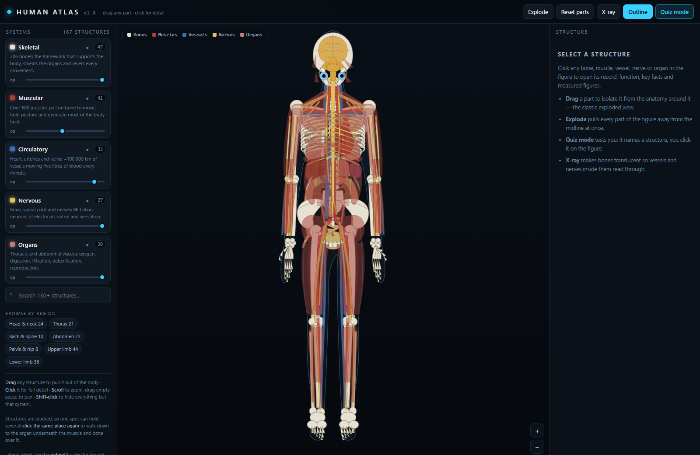

# Human Atlas

An interactive human anatomy atlas in **one HTML file** — no build step to run it, no dependencies, no network calls. Open `index.html` and it works, offline, over `file://`.

**167 structures · 5 systems · 502 written facts**



## What it does

- **Five systems**, each toggleable with its own opacity slider: skeletal (47), muscular (41), circulatory (32), nervous (27), organs (20).
- **Drag any structure** out of the body. Drag the same structure again to push it further; *Reset parts* puts everything back. *Explode* unfolds the whole figure, with the viscera staying near the midline while the skeleton and muscle shells step outward.
- **Click for a record**: every structure carries its name, Latin name, system, group, region, a function paragraph, three key facts, measured figures (with numbers), and links to the structures it works with.
- **Structures are stacked.** A spot on the chest holds a rib, a pectoral, a lung and an intercostal nerve. One click takes the topmost; clicking the same place again walks down the stack so nothing is unreachable under a muscle or the rib cage.
- **Quiz mode** names a structure and scores how fast you find it, with streak tracking.
- **X-ray** makes bones translucent so vessels and nerves read through them; **Outline** toggles the body silhouette.
- **Search** by common name, Latin name, region or system term; browse by region; *Locate* zooms to a structure; *Only system* isolates one layer.
- **Download the figure as SVG** — the export reuses the same render function as the canvas, so the file and the screen cannot drift apart.
- Pan by dragging empty space, zoom with the wheel, `+`/`−`/`0` to zoom and fit, `e` explode, `r` reset, `x` x-ray, `Esc` to clear.

Laterality follows clinical convention: the label says the **patient's** side, so the left of screen is the patient's right. Structures are drawn symmetrically and each pair is named in Latin with its side (*dexter* / *sinister*).

## Files

```
index.html                 the shipped artifact (single file, self-contained)
src/head.html              markup + CSS shell
src/core/00-base.js        geometry helpers, catalogue registry, render, state
src/core/10..50-*.js       per-system geometry (parametric, no hand-traced paths)
src/core/62..68-info-*.js  per-structure records
src/ui/10-view.js          rendering: canvas, sidebar, detail pane
src/ui/20-interact.js      pointer drag, pan/zoom, selection, quiz, export
src/ui/30-harness.js       boot, query-string modes, window.__ATLAS__ test hook
scripts/build.js           concatenates src/ into index.html
scripts/verify_app.js      tier 1 gate — 442 assertions, no browser needed
scripts/browser_check.js   tier 2 gate — drives real Chrome over CDP
scripts/shot.sh            screenshot helper (?sys=, ?pick=, ?explode=, …)
```

Edit anything under `src/` then rebuild:

```bash
node scripts/build.js        # -> index.html
npm run verify               # static + core assertions
npm run verify:browser       # 44 assertions in real Chrome, writes shots/
npm run verify:all
```

`index.html` also carries its own self-test: open it with `?selftest=1` and the title reports `SELFTEST PASS (n checks)`; `?autoplay=1` drives the whole app programmatically; `?metrics=1` reports layout width. Debug modes: `?sys=organs,skeletal`, `?pick=liver`, `?explode=1`, `?xray=1`, `?skin=0`, `?zoom=2`.

## Accuracy

Built from standard anatomical landmarks (head height ≈ 1/8 of stature, crotch at half stature, hip joint at ~47% of height, biacromial breadth ≈ 0.23 of stature) with the figures in each record taken from routine anatomical values. The artwork is a **schematic**: proportions and relative positions follow the real body, but this is a teaching figure, not a radiological or clinical reference. Nothing here is medical advice.

## Licence

MIT.
